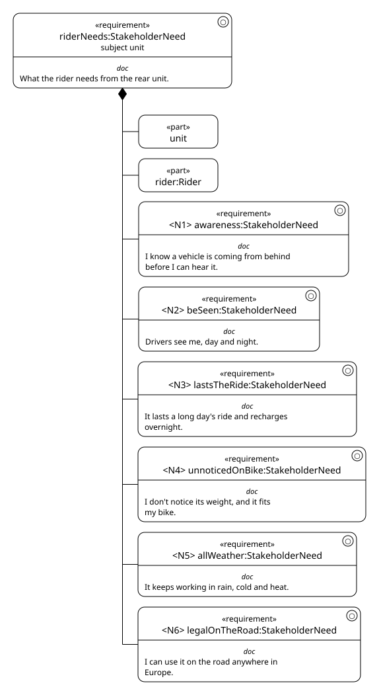
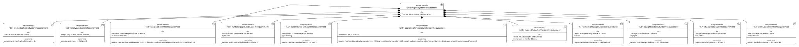
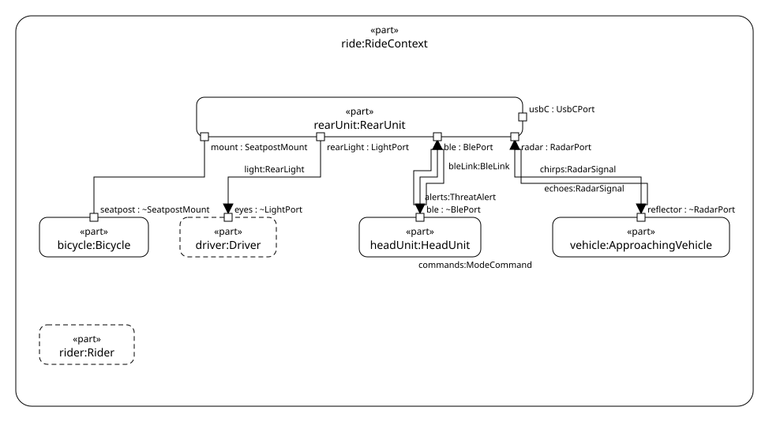
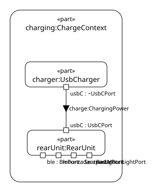
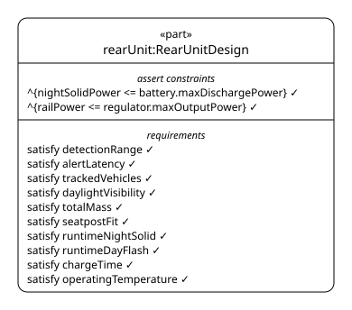
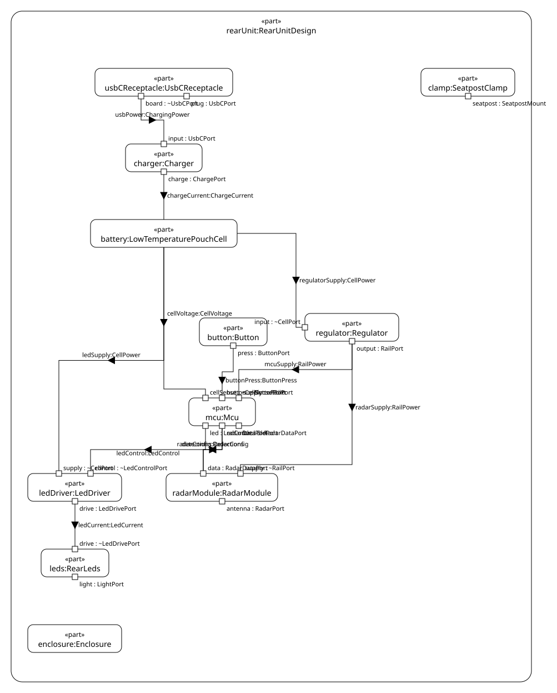

# Bike radar light

A SysML v2 Model of a rear radar light for bicycles: a 77 GHz radar that
warns the rider of vehicles approaching from behind, and a rear light, in one
seatpost-mounted unit. The product is fictional; the numbers are meant to be
realistic. See [PLAN.md](PLAN.md) for why it exists and how it grows.

| File | Contents |
|---|---|
| [`model/requirements.sysml`](model/requirements.sysml) | Rider needs, system requirements, derivation |
| [`model/context.sysml`](model/context.sysml) | The rear unit as a black box, its ports and external actors |
| [`model/architecture.sysml`](model/architecture.sysml) | The parts inside the rear unit and how they are wired |
| [`model/modes.sysml`](model/modes.sysml) | The operating modes, as a state machine |
| [`model/views.sysml`](model/views.sysml) | The Diagrams kept with the Model |

## Diagrams

Exported by `./scripts/check.sh` with the [SysML v2 Viewer](../sysmlv2_egui).

### Rider needs



### System requirements



### Ride context



### Charge context



### Part tree



### Internal structure



The operating modes view is a `StateTransitionView`, which the viewer does
not export yet.

## Check

```sh
./scripts/check.sh
```

Exports every view into `docs/img`, validates the Model with
[OpenSysML](https://github.com/Open-MBEE/OpenSysML)'s `sysml` as a second
opinion, then checks every requirement and asserted constraint. Nothing claims to satisfy a requirement yet, so every
requirement is Not claimed.

## Open in the viewer

```sh
cd ../sysmlv2_egui
WAYLAND_DISPLAY= cargo run --release -p viewer-app -- ../bike-radar-model/model
```
