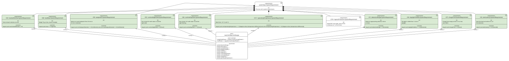
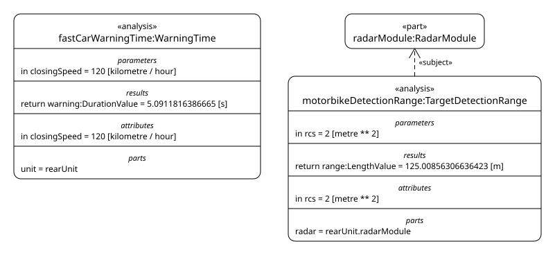
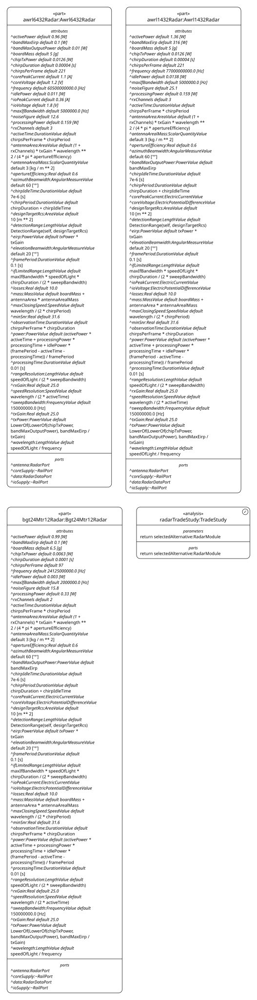
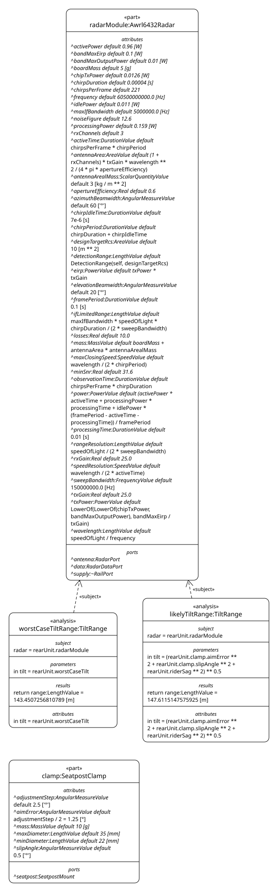
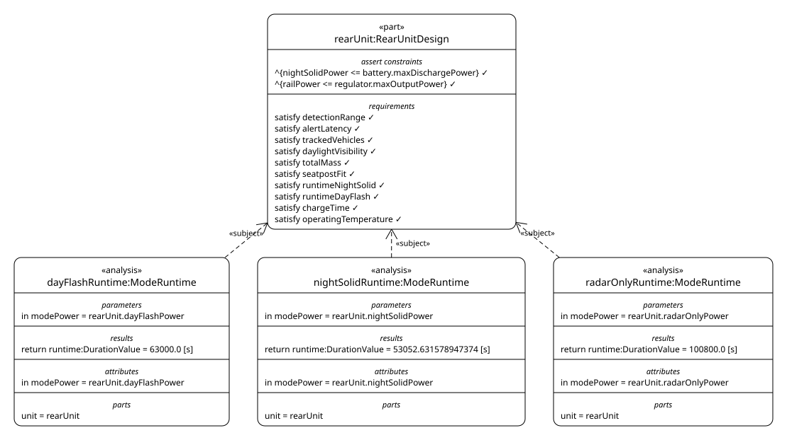
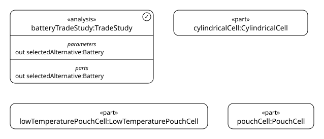
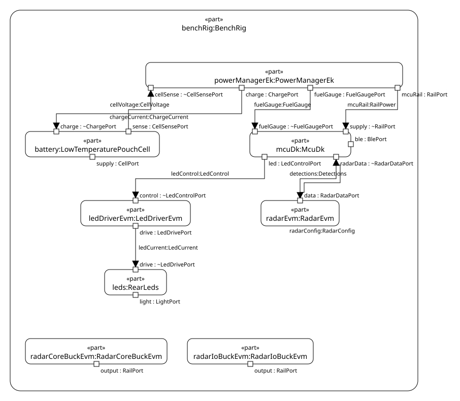

# Bike radar light

A SysML v2 Model of a rear radar light for bicycles: a 60 GHz radar that
warns the rider of vehicles approaching from behind, and a rear light, in one
seatpost-mounted unit. The product is fictional; the numbers are meant to be
realistic. See [PLAN.md](PLAN.md) for why it exists and how it grows.

| File | Contents |
|---|---|
| [`model/requirements.sysml`](model/requirements.sysml) | Rider needs, system requirements, derivation |
| [`model/context.sysml`](model/context.sysml) | The rear unit as a black box, its ports and external actors |
| [`model/architecture.sysml`](model/architecture.sysml) | The parts inside the rear unit, how they are wired, their mass and power, and the budgets they roll up to |
| [`model/modes.sysml`](model/modes.sysml) | The operating modes, as a state machine |
| [`model/analysis.sysml`](model/analysis.sysml) | Radar performance, runtime per operating mode, and the battery trade study |
| [`model/satisfaction.sysml`](model/satisfaction.sysml) | Which system requirements the rear unit as built claims to satisfy |
| [`model/bringup.sysml`](model/bringup.sysml) | The bench of dev kits the firmware is brought up on, and the production part each stands in for |
| [`model/views.sysml`](model/views.sysml) | The Diagrams kept with the Model |
| [`model/diagrams/style.json`](model/diagrams/style.json) | The Model Style: requirements green, yellow or red by satisfaction |

## Diagrams

Exported by `./scripts/check.sh` with the [SysML v2 Viewer](../sysmlv2_egui).

### Rider needs


### System requirements


### Ride context


### Charge context


### Part tree


### Internal structure


### Satisfaction



### Radar performance



### Radar trade study



### Mounting tilt



### Runtimes



### Battery trade study



### Bench rig



The operating modes view is a `StateTransitionView`, which the viewer does
not export yet.

## Check

```sh
./scripts/check.sh
```

Exports every view into `docs/img`, validates the Model with
[OpenSysML](https://github.com/Open-MBEE/OpenSysML)'s `sysml` as a second
opinion, then checks every requirement and asserted constraint.

Fourteen requirements are satisfied, and the other ten are not claimed: the
rider needs, the system spec that groups the rest, ingress protection, which
waits for a test, and the head unit protocols, which wait for firmware. The cell was first a 45 g cylindrical one, sized to
last 16 h of day flash cold and at the end of its life, which made the unit
88 g against the 75 g of S8. The battery trade study chose a 29 g
low-temperature pouch cell instead, and the unit now weighs about 74 g. The
radar trade study chose a 60 GHz radar chip, turned down to the band's
European limit, which leaves S1 a margin of only 3.5 m. The electronics
are now real parts, and the unit weighs about 73 g.

## Open in the viewer

```sh
cd ../sysmlv2_egui
WAYLAND_DISPLAY= cargo run --release -p viewer-app -- ../bike-radar-model/model
```
